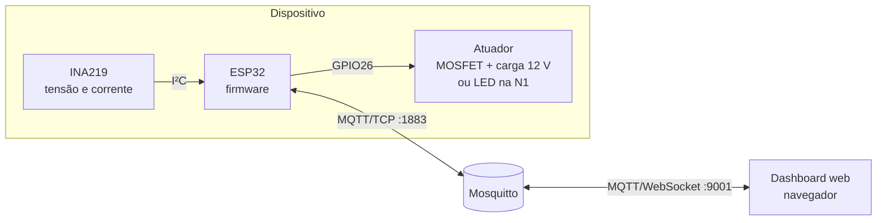

# EnergiaIOT

**Monitoramento e controle de energia em baixa tensão com ESP32, INA219, MQTT (Mosquitto) e dashboard web.**


Projeto acadêmico do **Grupo 7 (Consumo em Baixa Tensão)**, disciplina de **Internet das Coisas**, Católica SC, Prof. Edson Vaz Lopes.

> [!WARNING]
> Protótipo educacional, **somente para baixa tensão DC**. Não ligue nada deste projeto à rede elétrica (127/220 V) e não alimente o ESP32 diretamente com 12 V. Leia [Segurança elétrica](#segurança-elétrica) antes de montar.

---

## Sumário

- [Visão geral](#visão-geral)
- [O que está neste repositório (e o que não está)](#o-que-está-neste-repositório-e-o-que-não-está)
- [Arquitetura](#arquitetura)
- [Início rápido](#início-rápido)
- [Tópicos MQTT](#tópicos-mqtt)
- [Estrutura do repositório](#estrutura-do-repositório)
- [Documentação](#documentação)
- [Estado do projeto](#estado-do-projeto)
- [Segurança elétrica](#segurança-elétrica)
- [Equipe](#equipe)
- [Contribuindo](#contribuindo)
- [Licença e citação](#licença-e-citação)

## Visão geral

O EnergiaIOT mede **tensão, corrente e potência** de uma carga DC de baixa tensão e permite **ligar e desligar a carga remotamente**, com confirmação do estado que o dispositivo realmente aplicou.

O ciclo IoT completo, de ida e volta:

1. o **INA219** mede tensão e corrente da carga via I²C;
2. o **ESP32** calcula a potência e publica telemetria por Wi-Fi/MQTT;
3. o **broker Mosquitto** distribui as mensagens;
4. o **dashboard web** (MQTT sobre WebSocket) exibe os valores e envia comandos `ON`/`OFF`;
5. o ESP32 aplica o comando no atuador e publica a **confirmação**;
6. o firmware classifica a situação em `NORMAL`, `ATENCAO` ou `CRITICO` e desliga a carga quando a condição é crítica.

## O que está neste repositório (e o que não está)

O projeto passou por três etapas (N1, N2 e N3). **Nem tudo o que foi planejado ou testado pelo grupo tem código aqui.** A tabela abaixo é a referência do que existe de fato nesta branch.

| Componente | Situação | Onde |
|---|---|---|
| Firmware atual (carga via MOSFET, `device_id`, LWT, estado seguro) | ✅ No repositório, **fora do layout padrão** (ver [KI-01](docs/KNOWN_ISSUES.md#ki-01)) | [`Codigo.ina`](Codigo.ina) |
| Firmware N1 (carga LED, tópicos fixos) | ✅ No repositório, **legado** | [`firmware/esp32_energia/`](firmware/esp32_energia/) |
| Scanner I²C (diagnóstico do INA219) | ✅ No repositório | [`firmware/i2c_scanner/`](firmware/i2c_scanner/) |
| Configuração do broker Mosquitto | ✅ No repositório | [`broker/mosquitto.conf`](broker/mosquitto.conf) |
| Dashboard web (HTML + MQTT.js) | ✅ No repositório | [`dashboard/`](dashboard/) |
| Simulação lógica de 1 dispositivo no navegador | ✅ No repositório (não usa rede nem broker) | [`simulacao/`](simulacao/) |
| Documento de projeto CP12, diagramas e material da defesa N1 | ✅ No repositório | [`docs/`](docs/) |
| Frontend Vue 3 + Vite + TypeScript | ❌ **Não está aqui.** Starter N2 executado localmente em outra pasta | [Roadmap](docs/ROADMAP.md#n2--starter-de-software-fora-deste-repositório) |
| Backend Python + FastAPI | ❌ **Não está aqui.** Idem | [Roadmap](docs/ROADMAP.md#n2--starter-de-software-fora-deste-repositório) |
| PostgreSQL, Docker Compose, simulador de 2 dispositivos | ❌ **Não está aqui.** Idem | [Roadmap](docs/ROADMAP.md#n2--starter-de-software-fora-deste-repositório) |
| Notificações via Telegram | ❌ **Não está aqui.** Integração em andamento, entrega não confirmada | [Roadmap](docs/ROADMAP.md#telegram) |
| Contrato MQTT v1 em JSON (`energiaiot/v1/...`) | 📝 **Somente proposta** (CP12). Nenhum firmware implementa | [MQTT](docs/MQTT.md#proposta-v1-não-implementada) |
| Dois dispositivos físicos com cooler 12 V | 📝 Planejado para a N3 | [Hardware](docs/HARDWARE.md) |

## Arquitetura

Arquitetura **implementada neste repositório** (sem backend nem banco de dados):



O ESP32 fala MQTT puro (porta 1883). O navegador não abre conexões TCP diretas, por isso o dashboard usa MQTT sobre WebSocket (porta 9001). Sensor, atuador e interface só se encontram pelos tópicos MQTT.

A **arquitetura-alvo da N3** (dois dispositivos, FastAPI, PostgreSQL, Vue e Telegram) está em [`docs/ARCHITECTURE.md`](docs/ARCHITECTURE.md#arquitetura-alvo-n3-planejada) e no diagrama [`docs/diagramas/energiaiot_arquitetura.png`](docs/diagramas/energiaiot_arquitetura.png).

## Início rápido

Passo a passo completo em [`docs/FIRMWARE.md`](docs/FIRMWARE.md) e [`docs/HARDWARE.md`](docs/HARDWARE.md). Resumo:

### Pré-requisitos

- [Eclipse Mosquitto](https://mosquitto.org/download/) 2.x instalado no computador;
- [Arduino IDE](https://www.arduino.cc/en/software) 2.x com o core **esp32** (Espressif) e as bibliotecas **PubSubClient** e **Adafruit INA219**;
- ESP32 DevKit, módulo INA219 e a carga de baixa tensão; computador e ESP32 **na mesma rede Wi-Fi**.

### 1. Broker

```bash
mosquitto -c broker/mosquitto.conf -v
```

Anote o IP local do computador (`ipconfig` no Windows, `ip addr` no Linux, `ipconfig getifaddr en0` no macOS).

> [!CAUTION]
> Esta configuração aceita conexões **anônimas** em todas as interfaces. Use apenas em rede local de laboratório ([KI-17](docs/KNOWN_ISSUES.md#ki-17)).

### 2. Firmware

Copie `firmware/esp32_energia/secrets.h.example` para `secrets.h` **na pasta do sketch** e preencha Wi-Fi e IP do broker. O `secrets.h` é ignorado pelo Git.

- **Firmware atual (`Codigo.ina`)**: o arquivo não abre direto no Arduino IDE por causa da extensão e da localização. Copie-o para uma pasta de sketch própria fora do repositório e acrescente `device_id` ao seu `secrets.h`. Instruções em [`docs/FIRMWARE.md`](docs/FIRMWARE.md#firmware-atual-codigoina).
- **Firmware N1 (legado)**: abra `firmware/esp32_energia/esp32_energia.ino`, selecione *ESP32 Dev Module* e faça o upload.

Monitor serial em **115200 baud**. Para validar a fiação do sensor antes, grave `firmware/i2c_scanner/i2c_scanner.ino`: o INA219 deve aparecer em `0x40`.

### 3. Dashboard

Abra `dashboard/index.html` no navegador e informe:

| Campo | Valor |
|---|---|
| Host do broker | IP do computador com o Mosquitto |
| Porta WebSocket | `9001` |
| Prefixo dos tópicos | `energia/<device_id>` para o firmware atual, ou `energia/esp32_caio` para o firmware N1 |

O dashboard carrega a biblioteca MQTT.js de uma CDN, então o navegador precisa de acesso à internet na primeira carga ([KI-15](docs/KNOWN_ISSUES.md#ki-15)).

### Sem hardware

`simulacao/index.html` roda inteiramente no navegador e demonstra a lógica do protótipo N1 (um dispositivo, limites didáticos de 3,3 V). Ele **não** se conecta a um broker.

## Tópicos MQTT

Prefixo `energia/<id>/`. Payloads em **texto simples** (número ou palavra), sem JSON.

| Tópico (após o prefixo) | Direção | Payload |
|---|---|---|
| `telemetria/tensao` | ESP32 → broker | tensão em V |
| `telemetria/corrente` | ESP32 → broker | corrente em A |
| `telemetria/potencia` | ESP32 → broker | potência em W |
| `comando/carga` | dashboard → ESP32 | `ON` \| `OFF` |
| `confirmacao/carga` | ESP32 → broker | estado realmente aplicado, `ON` \| `OFF` |
| `alerta` | ESP32 → broker | `NORMAL` \| `ATENCAO` \| `CRITICO` |
| `status` | ESP32 → broker | `online` \| `offline` (LWT só no firmware atual) |

Diferenças entre as versões de firmware, QoS, retain e a proposta de contrato v1 em [`docs/MQTT.md`](docs/MQTT.md).

## Estrutura do repositório

```text
.
├── Codigo.ina                    # Firmware ATUAL do ESP32 (extensão e local fora do padrão, ver KI-01)
├── firmware/
│   ├── esp32_energia/
│   │   ├── esp32_energia.ino     # Firmware N1 (legado, carga LED)
│   │   └── secrets.h.example     # Modelo de credenciais (copiar para secrets.h)
│   └── i2c_scanner/
│       └── i2c_scanner.ino       # Diagnóstico do barramento I²C
├── broker/
│   └── mosquitto.conf            # Listeners 1883 (MQTT) e 9001 (WebSocket)
├── dashboard/                    # Dashboard web N1 (HTML + CSS + MQTT.js)
├── simulacao/
│   └── index.html                # Simulação lógica no navegador, sem rede
├── docs/
│   ├── README.md                 # Índice da documentação
│   ├── ARCHITECTURE.md · MQTT.md · FIRMWARE.md · HARDWARE.md
│   ├── ROADMAP.md · KNOWN_ISSUES.md
│   ├── diagramas/                # PNGs de arquitetura e fluxos (proposta N3)
│   └── *.pdf · *.pptx · *.docx   # Documentos acadêmicos (CP12, defesa N1, guia)
├── .github/                      # Templates de issue e pull request
├── CHANGELOG.md · CONTRIBUTING.md · SECURITY.md
├── CITATION.cff · LICENSE
└── .editorconfig · .gitignore
```

## Documentação

| Documento | Conteúdo |
|---|---|
| [`docs/ARCHITECTURE.md`](docs/ARCHITECTURE.md) | Arquitetura implementada x arquitetura-alvo, fluxos de dados e de comando |
| [`docs/MQTT.md`](docs/MQTT.md) | Contrato de tópicos atual por versão de firmware e proposta v1 |
| [`docs/FIRMWARE.md`](docs/FIRMWARE.md) | Versões do firmware, compilação, configuração e comportamento |
| [`docs/HARDWARE.md`](docs/HARDWARE.md) | Componentes, pinagem, montagem e regras de segurança |
| [`docs/ROADMAP.md`](docs/ROADMAP.md) | Evolução N1 → N2 → N3 e situação dos requisitos R1–R18 |
| [`docs/KNOWN_ISSUES.md`](docs/KNOWN_ISSUES.md) | Problemas conhecidos no código e na documentação |
| [`docs/EnergiaIOT_CP12_Projeto_v1_1.pdf`](docs/EnergiaIOT_CP12_Projeto_v1_1.pdf) | Documento de projeto CP12 (proposta N3) |

## Estado do projeto

| Item | Estado |
|---|---|
| Protótipo N1 (ESP32 + INA219 + LED + Mosquitto + dashboard) | Concluído e defendido |
| Firmware com MOSFET, `device_id`, LWT e estado seguro | Código no repositório; validação em hardware sem evidência registrada aqui |
| Starter N2 (Vue, FastAPI, PostgreSQL, Docker Compose, simulador) | Executado localmente pelo grupo; **não publicado neste repositório** |
| Notificações Telegram | Endpoint preparado fora do repositório; entrega não confirmada |
| Contrato MQTT v1 (JSON) | Proposto no CP12; não implementado |
| Dois dispositivos físicos com cooler 12 V | Planejado para a N3 |
| Testes automatizados e CI | Planejados (R18); inexistentes |

Detalhes e requisitos R1–R18 em [`docs/ROADMAP.md`](docs/ROADMAP.md).

## Segurança elétrica

- Somente cargas **DC de baixa tensão**. É proibida qualquer conexão à rede elétrica.
- Alimente o INA219 em **3,3 V** e nunca aplique 5 V ou 12 V a um GPIO do ESP32.
- Use **GND comum** entre fonte, sensor, ESP32 e estágio de acionamento.
- Cargas indutivas (cooler/motor) exigem diodo de roda livre ou a proteção indicada pelo fabricante; o MOSFET deve ser *logic-level* e ter resistor de *pull-down* no gate.
- Desligue tudo antes de remontar o circuito.
- Este é um protótipo educacional, não um produto certificado.

Regras completas em [`docs/HARDWARE.md`](docs/HARDWARE.md#regras-de-segurança). Para segredos e vulnerabilidades, veja [`SECURITY.md`](SECURITY.md).

## Equipe

| Integrante | GitHub | Responsabilidade principal na N3 (CP12) |
|---|---|---|
| Bruno Costa | a confirmar | Hardware, componentes e testes elétricos |
| Caio Rodrigues | [@caiorosa31](https://github.com/caiorosa31) | Hardware, componentes e testes elétricos |
| Iago Koch | [@iagokoch](https://github.com/iagokoch) | Firmware ESP32, INA219, estados de segurança e MQTT |
| João Francisco | [@joaofsdev](https://github.com/joaofsdev) | Firmware ESP32, INA219, estados de segurança e MQTT |
| Pedro Israel | [@p33drinho](https://github.com/p33drinho) | Backend, banco de dados, interface e integração |
| William Vodzinsky | a confirmar | Backend, banco de dados, interface e integração |

Todos os integrantes participam da revisão do contrato, da integração, dos testes e da documentação.

## Contribuindo

Fluxo de branches, padrão de commits e checklist de pull request em [`CONTRIBUTING.md`](CONTRIBUTING.md). Histórico de mudanças em [`CHANGELOG.md`](CHANGELOG.md).

## Licença e citação

Distribuído sob a licença MIT. Veja [`LICENSE`](LICENSE). Para citar o projeto, use os metadados de [`CITATION.cff`](CITATION.cff) (o GitHub exibe o botão *Cite this repository*).

---

<sub>EnergiaIOT · Grupo 7 · Internet das Coisas · Católica SC · 2026</sub>
