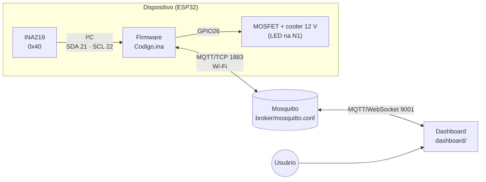
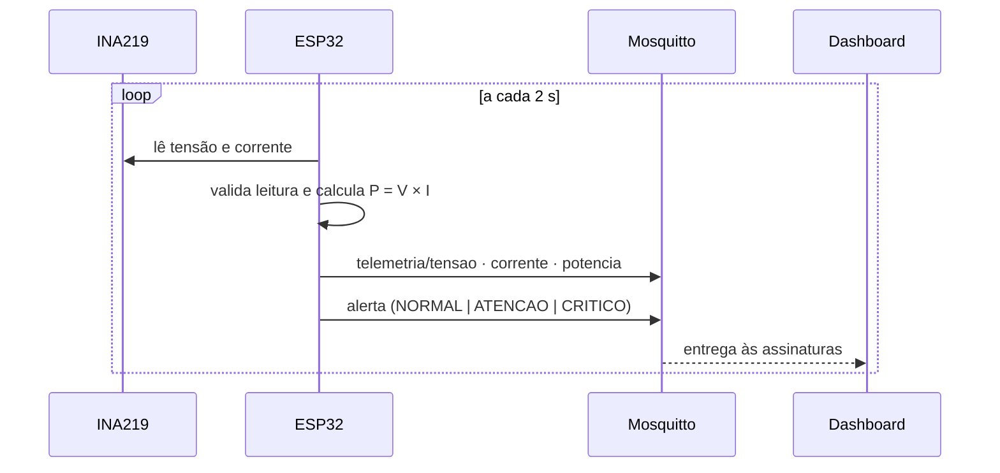
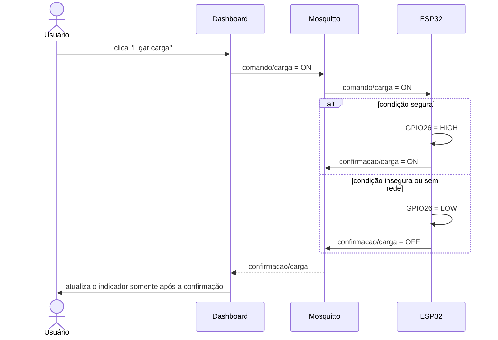
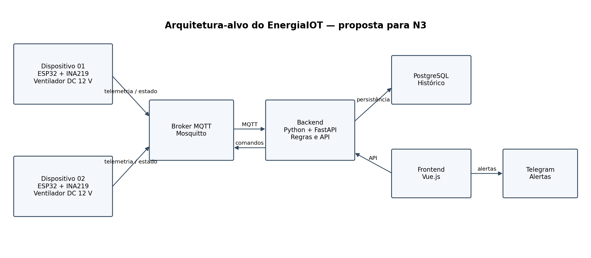

# Arquitetura

O EnergiaIOT tem duas arquiteturas documentadas: a que **está implementada neste repositório** e a **arquitetura-alvo da N3**, que ainda é proposta. Elas não devem ser confundidas.

## Arquitetura implementada

| Camada | Componente | Arquivo |
|---|---|---|
| Sensoriamento | INA219 (tensão de barramento e corrente no shunt) | — |
| Dispositivo | ESP32 com firmware Arduino/C++ | [`Codigo.ina`](../Codigo.ina), legado em [`firmware/esp32_energia/`](../firmware/esp32_energia/) |
| Atuação | MOSFET acionando cooler 12 V (atual) ou LED (N1) | — |
| Transporte | Eclipse Mosquitto, MQTT 3.1.1 | [`broker/mosquitto.conf`](../broker/mosquitto.conf) |
| Interface | Página estática com MQTT.js | [`dashboard/`](../dashboard/) |
| Demonstração | Simulação lógica sem rede | [`simulacao/`](../simulacao/) |

**Não há** backend, banco de dados, autenticação nem histórico: o dashboard mostra apenas o último valor recebido enquanto está aberto.

### Fluxo de telemetria

### Fluxo de comando e confirmação

O ramo "condição insegura" descreve o firmware atual. O firmware N1 aceita `ON` sem checar a condição ([KI-10](KNOWN_ISSUES.md#ki-10)).

### Decisões de projeto

| Decisão | Motivo |
|---|---|
| Broker próprio na rede local | Requisito da disciplina; sem dependência de serviço externo |
| WebSocket na porta 9001 | Navegadores não abrem conexões MQTT/TCP diretas |
| Payload em texto simples | Simplicidade na N1; a v1 propõe JSON versionado ([MQTT](MQTT.md)) |
| Confirmação em tópico próprio | Com QoS 0, a interface só confia no estado que o dispositivo confirma |
| Proteção local no firmware | A carga precisa ser desligada mesmo sem rede (implementado no firmware atual) |

## Arquitetura-alvo (N3, planejada)

> [!NOTE]
> Tudo nesta seção é **proposta** do documento [CP12](EnergiaIOT_CP12_Projeto_v1_1.pdf). Nenhum desses componentes tem código neste repositório.

| Camada | Proposta |
|---|---|
| Hardware | Dois dispositivos independentes (`energiaiot-01`, `energiaiot-02`), cada um com ESP32, INA219, MOSFET e ventilador DC 12 V |
| Firmware | Leitura não bloqueante, validação, regra local de segurança, NVS, `deviceId`, timestamp, logs e OTA |
| Comunicação | Mosquitto com contrato v1 em JSON, Last Will, QoS e retain justificados |
| Backend | Python + FastAPI: consome MQTT, valida, persiste, expõe API e é o único publicador de comandos |
| Banco | PostgreSQL: `devices`, `measurements`, `commands`, `device_configs`, `users`, `alerts` |
| Interface | Vue.js com autenticação, gráficos históricos, alertas e controle |
| Notificação | Telegram Bot API |
| Infra | Docker Compose; Pytest + GitHub Actions |

Diagramas complementares da proposta:

- [Fluxo de dados](diagramas/energiaiot_fluxo_dados.png)
- [Fluxo de comando](diagramas/energiaiot_fluxo_comando.png)
- [Fluxograma conceitual do firmware](diagramas/energiaiot_fluxograma_firmware.png): estados BOOT, AUTO, MANUAL e SEGURO. O firmware atual implementa só a parte de estado seguro; não há modo manual com timeout.

O diagrama de arquitetura mostra o frontend enviando alertas ao Telegram, enquanto o texto do CP12 atribui isso ao backend ([KI-21](KNOWN_ISSUES.md#ki-21)).

A evolução entre as etapas e a situação de cada requisito estão em [`ROADMAP.md`](ROADMAP.md).
