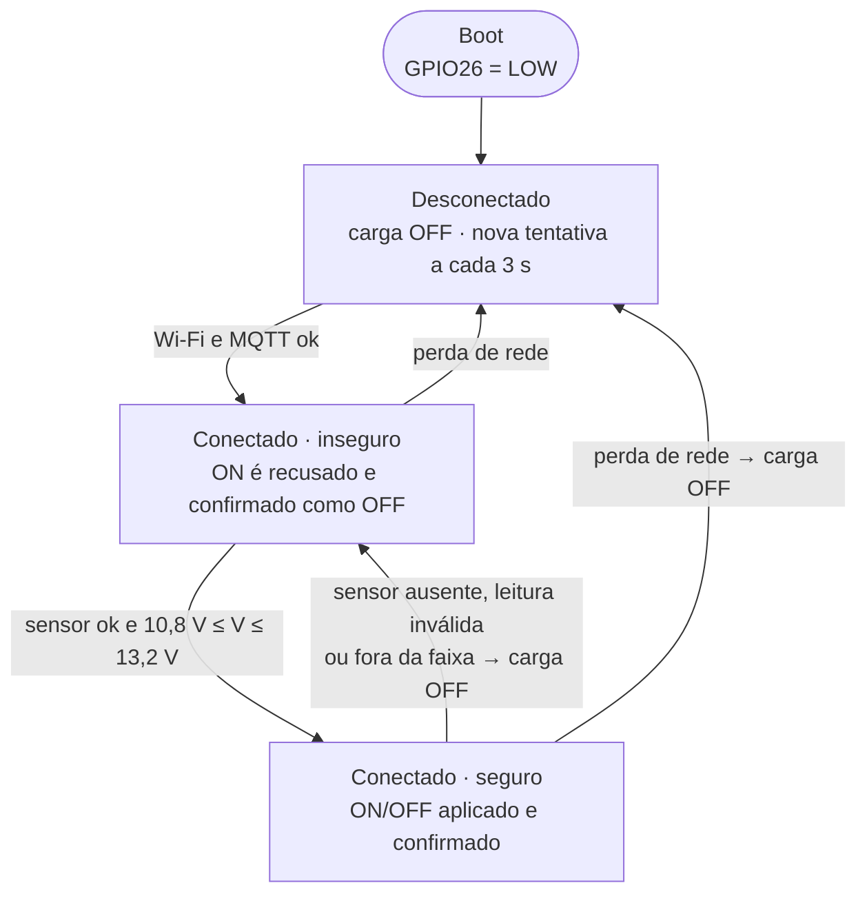

# Firmware do ESP32

O repositório tem **três sketches**. Esta página explica qual usar, como compilar e como cada um se comporta.

| Sketch | Papel | Situação |
|---|---|---|
| [`Codigo.ina`](../Codigo.ina) | Firmware **atual**: carga de 12 V via MOSFET, `device_id`, LWT, estado seguro | Gravado no ESP32 segundo o commit `9a0ab47`; fora do layout padrão ([KI-01](KNOWN_ISSUES.md#ki-01)) |
| [`firmware/esp32_energia/esp32_energia.ino`](../firmware/esp32_energia/esp32_energia.ino) | Firmware da **N1**: carga LED, tópicos fixos | Legado, mantido como histórico acadêmico |
| [`firmware/i2c_scanner/i2c_scanner.ino`](../firmware/i2c_scanner/i2c_scanner.ino) | Diagnóstico do barramento I²C | Utilitário |

## Pré-requisitos

| Item | Versão / observação |
|---|---|
| Arduino IDE | 2.x (ou `arduino-cli`) |
| Core de placas | **esp32** da Espressif (Gerenciador de Placas) |
| Placa | *ESP32 Dev Module* (ESP32 DevKit / ESP-WROOM-32) |
| Biblioteca | **PubSubClient** (Nick O'Leary) |
| Biblioteca | **Adafruit INA219**, numa versão em que `begin()` retorna `bool`, mais a dependência **Adafruit BusIO** |
| Broker | Mosquitto rodando conforme [`broker/mosquitto.conf`](../broker/mosquitto.conf) |

`WiFi.h` e `Wire.h` vêm com o core do ESP32.

## Credenciais (`secrets.h`)

As credenciais ficam em um `secrets.h` **na mesma pasta do sketch** e nunca são versionadas (o arquivo está no [`.gitignore`](../.gitignore)).

```cpp
// secrets.h — NÃO versionar
const char* ssid        = "NOME_DA_REDE_WIFI";
const char* password    = "SENHA_DA_REDE_WIFI";
const char* mqtt_server = "192.168.0.X";     // IP do computador com o Mosquitto
const char* device_id   = "energiaiot-01";   // só o firmware atual usa
```

O modelo [`secrets.h.example`](../firmware/esp32_energia/secrets.h.example) ainda **não** tem a linha `device_id` ([KI-02](KNOWN_ISSUES.md#ki-02)). Para o firmware atual, acrescente-a manualmente. Os IDs propostos no CP12 são `energiaiot-01` e `energiaiot-02`.

## Firmware atual (`Codigo.ina`)

O Arduino IDE só abre sketches `.ino` dentro de uma pasta com o mesmo nome. Até o arquivo ser movido no repositório ([KI-01](KNOWN_ISSUES.md#ki-01)), compile a partir de uma **cópia fora do repositório**:

```bash
# Linux/macOS. No Windows, faça o equivalente no Explorador de Arquivos.
mkdir -p ~/Arduino/energiaiot_device
cp Codigo.ina ~/Arduino/energiaiot_device/energiaiot_device.ino
cp firmware/esp32_energia/secrets.h.example ~/Arduino/energiaiot_device/secrets.h
# Edite secrets.h: preencha ssid, password, mqtt_server e ACRESCENTE device_id.
```

Depois abra `energiaiot_device.ino`, selecione *ESP32 Dev Module* e a porta serial e faça o upload.

Com `arduino-cli`:

```bash
arduino-cli compile --fqbn esp32:esp32:esp32 ~/Arduino/energiaiot_device
arduino-cli upload  --fqbn esp32:esp32:esp32 -p /dev/ttyUSB0 ~/Arduino/energiaiot_device
arduino-cli monitor -p /dev/ttyUSB0 -c baudrate=115200
```

### Comportamento

- **Boot:** gate do MOSFET (GPIO26) em `LOW`, ou seja, carga desligada. A conexão Wi-Fi é iniciada sem bloquear o loop.
- **Reconexão:** sem Wi-Fi ou sem MQTT, a carga é forçada a OFF e uma nova tentativa ocorre a cada 3 s. Ao conectar, o firmware registra o LWT (`status = offline`, retido), apaga um eventual comando retido, assina `comando/carga`, publica `status = online` (retido) e confirma `OFF`.
- **Medição (a cada 2 s):** verifica se o INA219 responde em `0x40`, tenta reinicializá-lo se tiver sumido e lê tensão de barramento e corrente.
- **Condição segura:** sensor presente **e** leituras finitas **e** `10,8 V ≤ V ≤ 13,2 V`. Fora disso, a carga é desligada.
- **Comando:** `ON` só liga a carga se a condição for segura e houver Wi-Fi e MQTT; caso contrário a confirmação é `OFF` ([KI-04](KNOWN_ISSUES.md#ki-04)). `OFF` é sempre aceito.
- **Alerta:** `CRITICO` se não for seguro; `ATENCAO` se `V ≥ 12,6 V`; senão `NORMAL`. Publicado (retido) a cada ciclo ([KI-05](KNOWN_ISSUES.md#ki-05)).
- **Serial:** `V=… I=… P=… carga=ON|OFF` a cada 2 s, em 115200 baud.



> Os limites `VMIN`, `VMAX` e `VAVISO` estão marcados no código como **ilustrativos**. Confirme-os com a fonte e o cooler reais ([KI-08](KNOWN_ISSUES.md#ki-08)).

## Firmware N1 (`firmware/esp32_energia/`)

1. Copie `secrets.h.example` para `secrets.h` na mesma pasta e preencha `ssid`, `password` e `mqtt_server`.
2. Abra `esp32_energia.ino`, selecione *ESP32 Dev Module* e a porta e faça o upload.
3. No monitor serial (115200 baud), confira a conexão e as leituras.

### Comportamento

- Conecta ao Wi-Fi e ao broker de forma **bloqueante** ([KI-11](KNOWN_ISSUES.md#ki-11)).
- Publica tensão, corrente e potência a cada 2 s em `energia/esp32_caio/telemetria/*`.
- `ON`/`OFF` em `comando/carga` acionam o LED no GPIO26 e são confirmados em `confirmacao/carga`.
- Estados por tensão: `NORMAL` < 4,5 V ≤ `ATENCAO` ≤ 5,5 V < `CRITICO`. O alerta só é publicado na mudança de estado, e a carga é desligada na **transição** para `CRITICO` ([KI-10](KNOWN_ISSUES.md#ki-10)).
- `POT_PIN` (GPIO34) está declarado, mas não é usado.

## Comparação das versões

| Aspecto | `Codigo.ina` (atual) | `esp32_energia.ino` (N1) |
|---|---|---|
| Carga / atuador | Cooler 12 V via MOSFET, gate no GPIO26 | LED no GPIO26 |
| Prefixo MQTT | `energia/<device_id>` | `energia/esp32_caio` (fixo) |
| `client_id` MQTT | `device_id` | `esp32_energia_01` (fixo) |
| Credenciais | `ssid`, `password`, `mqtt_server`, **`device_id`** | `ssid`, `password`, `mqtt_server` |
| Conexão | Não bloqueante, nova tentativa a cada 3 s | Bloqueante (`while`) |
| Estado sem rede | Carga forçada a OFF | Mantém o último estado |
| Validação do sensor | Presença no I²C, `isfinite`, faixa de tensão | Nenhuma |
| Faixa segura | 10,8–13,2 V; atenção a partir de 12,6 V | Atenção 4,5 V; crítico acima de 5,5 V |
| `ON` em condição insegura | Recusado | Aceito ([KI-10](KNOWN_ISSUES.md#ki-10)) |
| LWT | `status = offline`, retido | Não |
| Retain | `status`, `alerta`, `confirmacao/carga` | Nenhum |
| Comando retido antigo | Apagado ao conectar | Não tratado |
| Alerta | A cada ciclo | Só na mudança |
| Normaliza payload (`trim`) | Não ([KI-06](KNOWN_ISSUES.md#ki-06)) | Sim |

Nenhuma das versões implementa o contrato v1 em JSON do CP12; veja [`MQTT.md`](MQTT.md).

## Scanner I2C

Use antes do firmware completo para validar a fiação (o principal risco técnico registrado na N1):

1. Grave `firmware/i2c_scanner/i2c_scanner.ino`.
2. Abra o monitor serial em 115200 baud.
3. O INA219 deve aparecer em **`0x40`** (endereço padrão, com A0 e A1 em GND).

"Nenhum dispositivo encontrado" indica problema em SDA (GPIO21), SCL (GPIO22), VCC (3,3 V) ou GND.

## Testando sem dashboard

Com o [Mosquitto](https://mosquitto.org/) instalado, os clientes de linha de comando bastam:

```bash
# Acompanhar tudo de um dispositivo
mosquitto_sub -h <ip-do-broker> -t 'energia/energiaiot-01/#' -v

# Enviar comandos
mosquitto_pub -h <ip-do-broker> -t 'energia/energiaiot-01/comando/carga' -m ON
mosquitto_pub -h <ip-do-broker> -t 'energia/energiaiot-01/comando/carga' -m OFF
```

Para o firmware N1, troque o prefixo por `energia/esp32_caio`.
