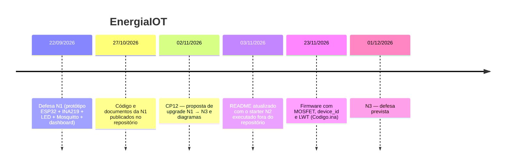

# Roadmap e evolução

Este documento separa três coisas: **o que existe neste repositório**, **o que o grupo executou em outro lugar** e **o que está apenas planejado**. Nenhum item planejado deve ser apresentado como implementado sem código, teste e evidência correspondentes.

## Linha do tempo



## N1 — Protótipo inicial (concluído)

ESP32, INA219, LED como carga, broker Mosquitto e dashboard web via MQTT/WebSocket. Tudo está neste repositório; veja [`FIRMWARE.md`](FIRMWARE.md) e [`HARDWARE.md`](HARDWARE.md). Pendências registradas na época: validação de leitura inválida, Last Will e calibração dos limites.

## N2 — Starter de software (fora deste repositório)

> [!IMPORTANT]
> O código desta seção **não está neste repositório**. Segundo o README anterior, ele foi executado localmente em uma pasta separada (`EnergiaIOT_software_telegram`) e ainda não foi publicado.

Componentes relatados pelo grupo:

| Camada | Tecnologia | Situação relatada |
|---|---|---|
| Frontend | Vue 3 + Vite + TypeScript | Executado localmente; dashboard com gráficos de dados simulados |
| API | Python + FastAPI | Executada localmente; endpoints de dispositivos, medições e comandos |
| Banco | PostgreSQL 16 | Container saudável nos testes |
| Mensageria | Eclipse Mosquitto | Container iniciado |
| Simulação | Simulador de **dois** dispositivos virtuais | Executado localmente (não confundir com [`simulacao/`](../simulacao/), que é a página da N1) |
| Orquestração | Docker Compose (`frontend`, `api`, `db`, `mqtt`, `simulator`) | Os cinco serviços iniciaram |

Instruções relatadas para aquele pacote, válidas **apenas na pasta do pacote**, não na raiz deste repositório:

```bash
docker compose up -d --build
docker compose ps
# Dashboard: http://localhost:5173
# API docs:  http://localhost:8000/docs
# Health:    http://localhost:8000/health
```

### Ao publicar o starter neste repositório

- Preservar `dashboard/` e `firmware/` da N1 como legado.
- Adicionar a nova aplicação em diretórios próprios (`backend/`, `frontend/`, `simulator/`, `infra/`).
- Versionar `.env.example` **sem segredos**; o `.env` já está no [`.gitignore`](../.gitignore).
- Manter um único arquivo Compose (não deixar `compose.yaml` e `docker-compose.yml` divergentes).
- Atualizar o [`README.md`](../README.md#o-que-está-neste-repositório-e-o-que-não-está) e o [`CHANGELOG.md`](../CHANGELOG.md).

Estrutura sugerida pelo CP12:

```text
firmware/device/   backend/   frontend/   infra/mosquitto/   infra/compose.yaml
docs/   CONTRATOS.md   README.md   .env.example   .gitignore
```

## Telegram

Integração **em andamento, fora deste repositório**.

- Foi preparada uma versão do starter com o endpoint `POST /notifications/test`, autenticado por chave de API, e configuração via `TELEGRAM_BOT_TOKEN` e `TELEGRAM_CHAT_ID`.
- No último teste relatado, as variáveis não chegavam ao container `api`. **A entrega de mensagens não foi confirmada.** Um retorno de enfileiramento não comprova entrega.
- Bot do projeto: [@IOTzinhobot](https://t.me/IOTzinhobot).
- Um token do bot foi exposto durante a configuração e **deve ser revogado no BotFather** antes do uso contínuo. Veja [`SECURITY.md`](../SECURITY.md).

Eventos de alerta desejados: comando confirmado, consumo elevado, falha de sensor, perda de comunicação e reconexão.

## N3 — Integração física (planejada)

Dois conjuntos independentes, cada um com ESP32, INA219, cooler 12 V e MOSFET *logic-level*, integrados ao backend, banco, frontend e Telegram. Detalhes em [`ARCHITECTURE.md`](ARCHITECTURE.md#arquitetura-alvo-n3-planejada) e [`HARDWARE.md`](HARDWARE.md#configuração-alvo-n3-e-pendências).

Regras de firmware previstas: carga desligada no boot, validação de medições, confirmação do estado aplicado, reconexão automática, descarte de comandos retidos antigos, desligamento em condição crítica, modos **seguro**, **manual** e **automático** (nessa ordem de prioridade), LWT/keep alive e validação com hardware real.

### Cronograma do CP12

| Data | Marco | Entrega prevista |
|---|---|---|
| até 03/11/2026 | Revisão N2 | Fechar requisitos, tópicos MQTT e diagramas |
| 10/11/2026 | Unidade 3, etapa 1 | Validar componentes; montar um dispositivo |
| 17/11/2026 | Unidade 3, etapa 2 | Segundo dispositivo; integrar MQTT, backend, PostgreSQL e API |
| 24/11/2026 | Unidade 3, etapa 3 | Vue, regras, notificações, Compose, segurança, OTA e testes |
| 01/12/2026 | Defesa N3 | Dois dispositivos físicos, painel, histórico, ciclo de comando e falhas |

## Requisitos R1–R18

Situação **com base no que existe neste repositório** em 24/11/2026. "Fora do repo" indica trabalho relatado pelo grupo sem código publicado aqui.

| Req. | Tema | Situação neste repositório |
|---|---|---|
| R1 | Hardware: 2 pontos de medição, acionamento por MOSFET | 🟡 Firmware prevê MOSFET; esquema e evidência física ausentes |
| R2 | Firmware: não bloqueante, validação, estado seguro, reconexão, NVS, `deviceId`, timestamp, logs | 🟡 Parcial em `Codigo.ina`: não bloqueante, validação de faixa, OFF no boot, reconexão, `device_id` e logs. Faltam NVS e timestamp |
| R3 | Contrato MQTT versionado em JSON, `commandId`, LWT, QoS/retain justificados | 🟡 Só LWT (firmware atual). Contrato v1 apenas proposto ([MQTT](MQTT.md)) |
| R4 | Backend FastAPI | 🔴 Fora do repo |
| R5 | Banco PostgreSQL com migrações | 🔴 Fora do repo |
| R6 | Interface com histórico, online/offline, alertas | 🟡 Dashboard N1 sem histórico nem indicador de online; Vue fora do repo |
| R7 | Ciclo de comando com estados distintos | 🟡 Confirmação `ON`/`OFF` existe; sem `commandId` nem aceite/rejeição explícitos |
| R8 | Decisão remota no backend | 🔴 Não implementado |
| R9 | Login, autenticação, segredos fora do repositório | 🟡 `secrets.h` e `.env` ignorados; broker e dashboard sem autenticação |
| R10 | Testes de falha com evidências | 🔴 Sem evidências registradas |
| R11 | Entrega executável: README, `.env.example`, release/tag | 🟡 README e guias atualizados; sem `.env.example` nem tag |
| R12 | Docker Compose | 🔴 Fora do repo |
| R13 | Múltiplos dispositivos | 🟡 Firmware atual parametrizado por `device_id`; sem evidência de dois dispositivos |
| R14 | Painel analítico com dados persistidos | 🔴 Não implementado |
| R15 | Notificação externa (Telegram) | 🔴 Fora do repo; entrega não confirmada |
| R16 | Perfis e autorização | 🔴 Não implementado |
| R17 | OTA | 🔴 Não implementado |
| R18 | Testes automatizados e CI | 🔴 Não implementado |

Legenda: 🟢 atendido com evidência · 🟡 parcial · 🔴 ausente neste repositório.
